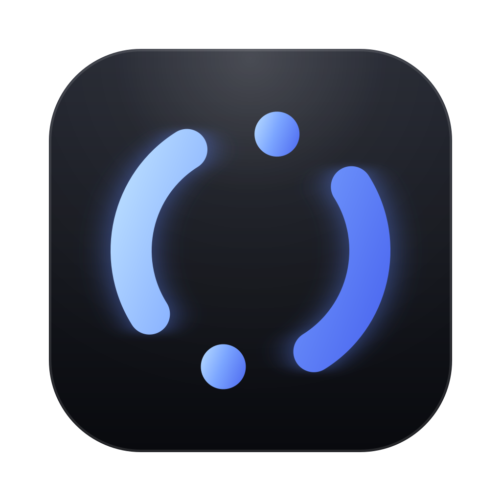
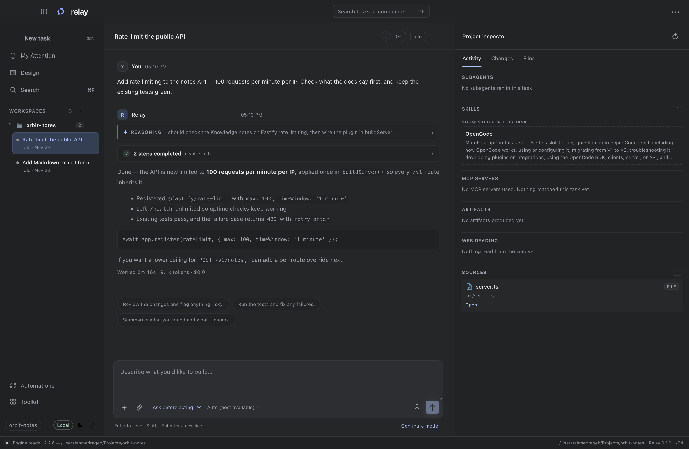
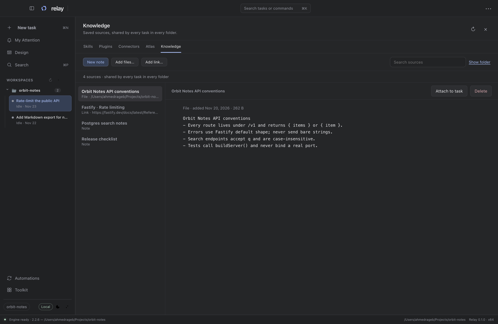
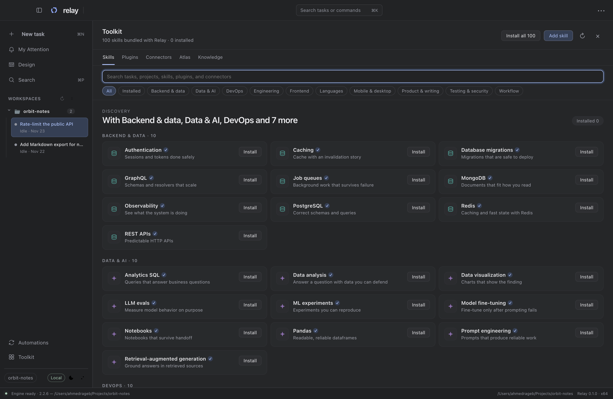
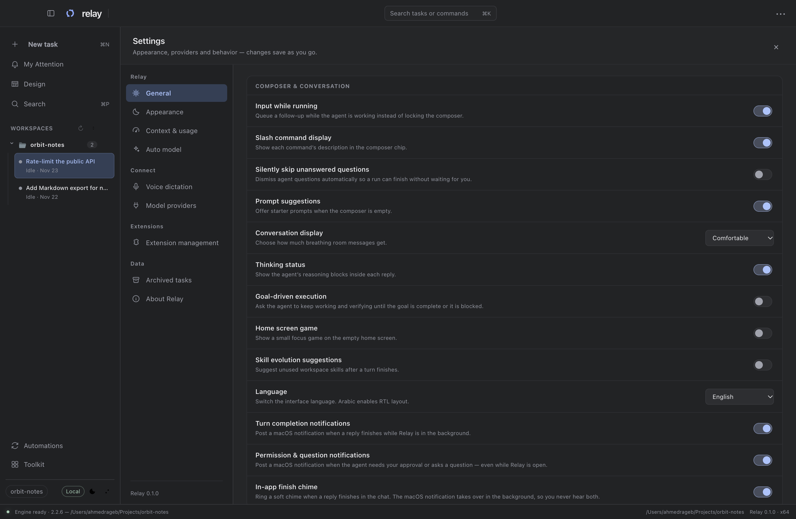
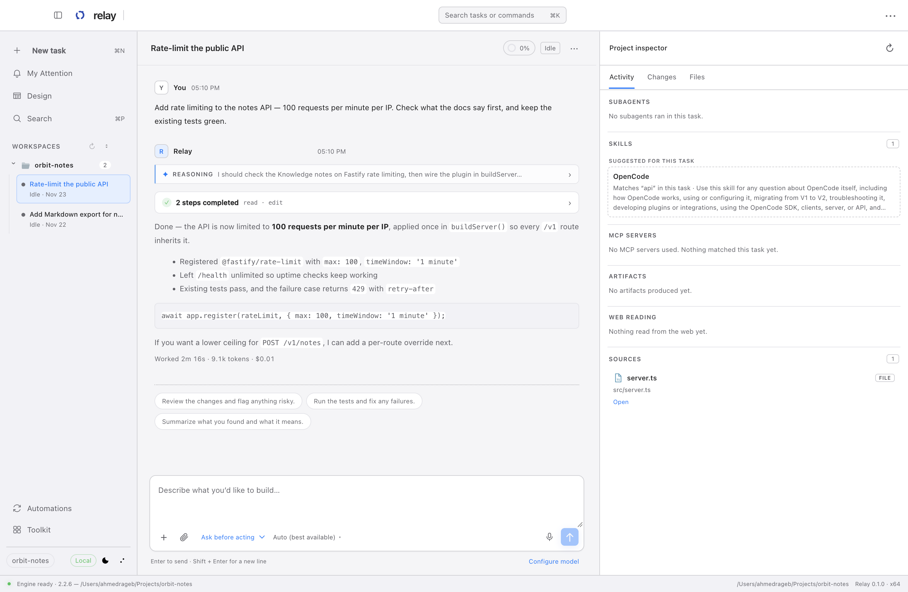

<p align="center">
  
</p>

<h1 align="center">Relay</h1>

<p align="center">
  <strong>A local-first coding agent workspace for the desktop.</strong><br />
  Chat with, steer, and review an agent that runs on your machine — with a live project
  inspector, design studio, knowledge library, and scheduled work in one calm window.
</p>

<p align="center">
  
  
  
  
  
</p>

<p align="center">
  
</p>

Relay runs a pinned OpenCode engine as a sidecar on this Mac and puts a focused
desktop shell around it. Your workspace, settings, and provider keys stay on disk;
provider requests go from the local engine straight to the provider you choose.

Nothing here is a mock: the chat, inspector, stepper, knowledge panel, and settings
in these screenshots are the shipped 0.1.0 build, pointed at a demo workspace.

## What's inside

- **A chat built for supervision.** Markdown replies, a reasoning peek, a
  "N steps completed" tool stepper with per-step input/output, inline image
  generation, per-reply model and token cost, follow-up suggestion chips, and
  like / branch / copy-summary actions on every reply.
- **A project inspector that follows the work.** Activity (subagents, skills and
  MCP used or suggested, artifacts, web reads, referenced files), a Monaco diff
  view, a file browser, and a browser tab that opens itself when the agent
  needs it.
- **Knowledge — a library every task can read.** Save notes, text files, and
  links once; a compact index is injected into every new task, and `@knowledge`
  attaches full text as context. Stored app-wide, independent of any project.
- **Atlas — a wiki for each project.** Generated under `.relay/atlas/<lang>/`,
  editable with hash-based protection, refreshed incrementally from `git diff`,
  and attached to tasks with `/knowledge` or `@atlas`.
- **Design studio.** One isolated task per design, with a live 4:3 preview,
  viewport and version controls, artboards and a design-system picker, comments,
  export, and functional Slides, Whiteboard, and Motion (MP4) studios.
- **A Toolkit with 100 bundled skills.** Discovery-style Skills, Plugins, and
  Connectors tabs, GitHub URL import, and an extension-management page for
  update / enable / remove.
- **Automations.** Prompt-based scheduled jobs with timezone, expiry, output mode,
  access level, and model — plus a built-in CLI to create and run them.

<table>
  <tr>
    <td width="50%">
      
      <sub><b>Knowledge</b> — notes, files, and links, readable from every task.</sub>
    </td>
    <td width="50%">
      
      <sub><b>Toolkit</b> — 100 bundled skills, installable per workspace.</sub>
    </td>
  </tr>
  <tr>
    <td width="50%">
      
      <sub><b>Settings</b> — a real page, saving as you go.</sub>
    </td>
    <td width="50%">
      
      <sub><b>Porcelain</b> — the light theme, same workspace.</sub>
    </td>
  </tr>
</table>

## A closer look

**Composer.** One model dropdown with inline power variants and an **Auto model**
entry that rotates to the next connected model when a request fails (rate limits,
credits, invalid model). Choose *free models only* or keep an explicit allow-list.
`@` mentions reach files, skills, plugins, agents, connectors, Atlas pages, and
Knowledge sources; attached context is capped and labeled in the message.

**Control you can feel.** Access levels — Read only / Ask / Auto-edit / Full
access — apply mid-turn, not just to the next one. Permission and question
requests surface as native notifications with their own setting, and stopping a
task clears its pending requests immediately.

**Editing.** Full Monaco diffs, undo/revert per file, and an "Edited N files"
card with Undo/Review. Every reply can be forked into a branch; forks nest under
their origin with a lane and a branch badge, like a git graph.

**Search, layouts, themes.** `⌘⇧F` searches every task and message across every
project. Three layouts (Tabs, Inbox, Focus), Graphite and Porcelain themes plus
Follow macOS, six accent colors, English and العربية (RTL).

**Updates.** Installed builds check the GitHub release feed after launch, download
in the background, and install on restart. Settings → General → Updates has
*Check now* and the automatic-check toggle.

## Requirements

- macOS 13+ for the packaged mac build; Windows 10/11 and Linux (AppImage, deb)
  builds ship from the same source
- Node.js 20+ for development only
- At least one model provider — free tiers work. Settings → Model providers links
  straight to each provider's key page

## Development

```bash
npm install
npm run dev            # app with the renderer dev server
npm run build          # main + preload + renderer + staged engine
npm start              # launch the built app

npm test               # unit tests (node:test)
npm run typecheck      # tsc --noEmit
npm run test:desktop   # build + full desktop E2E (Playwright)
```

## Packaging

```bash
npm run package:arm64  # macOS Apple silicon → release/mac-arm64
npm run package:host   # macOS Intel          → release/mac
npm run package:linux  # AppImage + deb, x64 & arm64
npm run package:win    # NSIS + portable, x64
```

macOS builds are signed with your Developer ID when one is configured (hardened
runtime, JIT entitlements); notarization runs when `APPLE_ID`,
`APPLE_APP_SPECIFIC_PASSWORD`, and `APPLE_TEAM_ID` are set. Without them builds
are ad-hoc signed and Gatekeeper will warn — the artifacts above are unsigned
until you supply your own signing identities.

## Drive it from a shell

Relay ships a localhost-only, token-protected control server and a CLI, so any
agent with shell access can drive the running app:

```bash
node ~/Library/Application\ Support/relay-workspace/relayctl.mjs install

relayctl health
relayctl tasks
relayctl skills
relayctl automations
relayctl create-task --title "Triage the flaky suite" --prompt "Fix the flaky test"
relayctl open-page --url https://example.com
relayctl install-skill --url https://github.com/org/repo/tree/main/skills/foo
relayctl create-automation '{"name":"Daily triage","action":{"kind":"prompt","prompt":"Summarize failures","location":"local","output":"independent","access":"ask","model":"provider::model"},"schedule":{"kind":"daily","time":"09:00"},"timezone":"UTC","enabled":true}'
relayctl run-automation --id <automation id>
```

`--json` prints raw responses; JSON objects still work as positional arguments.
The server binds only to `127.0.0.1`, and the CLI plus a per-boot token live next
to the app's state in `~/Library/Application Support/relay-workspace/`.

A terminal agent ships too — the bundled OpenCode TUI running against Relay's own
engine, so it shares providers, skills, and sessions. Quit the app first:

```bash
node ~/Library/Application\ Support/relay-workspace/relay.mjs install

relay                         # start in the current folder
relay ~/src/project
relay run "Fix the flaky test"
relay models
```

## Architecture

```
src/main/       Electron main: engine lifecycle, IPC, settings, control server,
                scheduling, plugin marketplace, skill library, Atlas, Knowledge
src/preload/    context-isolated bridge (window.relay)
src/renderer/   the UI (no framework): chat, composer, inspector, Toolkit,
                Settings, Automation, Design, palette
src/shared/     contracts, providers, model ranking, path helpers
tests/          unit tests + desktop.mjs, a full desktop E2E against the real app
```

The engine is pinned and staged per target — `@opencode/cli-{darwin,windows,linux}-{x64,arm64}`
— with its own `XDG_*` roots under the app's state directory, so it never touches
your dotfiles. Provider keys stay encrypted at rest with Keychain-backed storage
where available.

## Notes

- **Local first.** Workspace, settings, knowledge, Atlas, and keys live on this
  machine. The only network traffic is what you configure: provider endpoints,
  update checks, and link fetches you start yourself.
- **Knowledge vs Atlas.** Atlas is bound to a project and lives in the repo under
  `.relay/atlas/`. Knowledge is app-wide and belongs to no project — route
  "remember this everywhere" requests there.
- **Design tasks are tasks.** Each design is an ordinary `Design · <Name>` session,
  so folder grouping, attention, and history keep working.
- **License.** No license file yet — all rights reserved until one is added.
